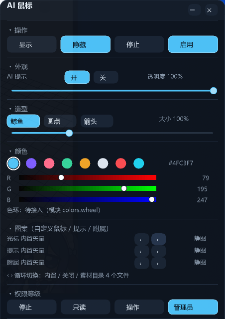
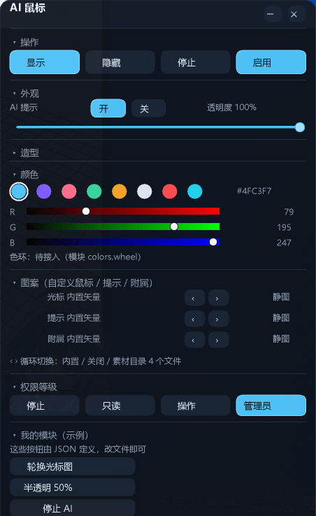

# 面板模块（Sections）开发说明






面板不是一整块写死的界面，而是由**分区（section）**堆叠而成。分区只负责「声明自己有哪些部件」，
不负责画、也不负责处理点击——画和命中都由框架统一做。这样新增模块是局部改动，也就意味着**别人（或 AI）
可以只改一个地方就扩展面板**，不用碰渲染代码。

## 1. 一个分区长什么样

```rust
pub struct SecDef {
    pub key: &'static str,              // 折叠状态与分发的稳定标识
    pub header: &'static str,           // 标题行的部件 id（点它切换折叠）
    pub title: &'static str,            // 面板上显示的名字
    pub default_collapsed: bool,        // 初始是否收起
    pub render: fn(&PanelView, i32, i32, &mut Vec<Hit>) -> i32,  // (view, x, y, out) -> 结束时的 y
}
```

注册就是往 `SECTIONS` 里加一项：

```rust
pub const SECTIONS: &[SecDef] = &[
    SecDef { key: "actions", header: "sec_actions", title: "操作", default_collapsed: false, render: body_actions },
    // ...
];
```

## 2. 分区能声明什么部件

`Hit` 是唯一的产物。它的字段：

| 字段 | 作用 |
|---|---|
| `r` | 矩形（面板坐标，左上原点） |
| `kind` | 部件类型，决定绘制方式与命中优先级 |
| `id` | 点击时回传的标识（`&'static str`，全局唯一） |
| `text` | 显示文字（滑条用数值） |
| `active` | 高亮态（按钮选中、滑条已填充） |
| `hover` | 悬停态（由框架回填，分区自己不要设） |
| `data` | 附带的整数参数（颜色通道 0/1/2 之类） |

可用 `kind`：

| kind | 外观 | 命中优先级 |
|---|---|---|
| `Button` | 圆角按钮，`active` 时用主色填充 | 0 |
| `Swatch` | 圆形色板 | 0 |
| `Section` | 分区标题行（带三角） | 0 |
| `Slider` | 0..1 滑条 | 1 |
| `Channel` | 0..255 通道条（带渐变） | 1 |
| `Wheel`（预留） | 色环 | 1 |
| `Label` / `LabelRight` | 左/右对齐文字，不可点 | 3 |
| `Sep` | 1px 分隔线 | 3 |

`render` 必须返回**自己占用到的 y**，框架据此往下堆叠；面板总高度由所有分区求和得出，
窗口大小随之变化，不需要写死。

## 3. 加一个分区要做的事

1. 在 `overlay/src/sections.rs` 写一个 `body_xxx(v: &PanelView, x: i32, y: i32, out: &mut Vec<Hit>) -> i32`，
   往 `out` 里 push 部件，返回结束的 y。
2. 在 `SECTIONS` 里加一行 `SecDef`。
3. 如果部件需要新的语义（比如按下去要改状态），在 `main.rs` 的 `on_toggle()` 里按 `id` 分支处理。
   需要新状态就在 `St` 加字段，并在 `view_of()` 里塞进 `PanelView`。
4. `cargo build --release`，`cp overlay/target/release/ai-mouse-overlay.exe bin/`，重启宿主。

## 4. 现有分区

| key | 标题 | 状态 |
|---|---|---|
| `actions` | 操作 | ✅ 显示/隐藏/停止/启用 |
| `appearance` | 外观 | ✅ AI 提示开关、透明度 |
| `style` | 造型 | ✅ 鲸鱼/圆点/箭头、大小 |
| `colors` | 颜色 | ✅ 色板 + 256 级 RGB 三通道条 + **色环（色相环 + 明度/饱和度方块）** |
| `artwork` | 图案（自定义鼠标 / 提示 / 附属） | 🟡 三个槽位 + `‹ ›` 循环切换（大小/偏移/透明度/翻转待接） |
| `permission` | 权限等级 | ✅ 四档 |
| `custom` | 自定义模块（JSON 驱动） | ✅ **读取 `custom-section.json`，标题可改** |

## 5. 预留的空位（`custom`）

`custom` 是一个**真实注册、但没有部件**的分区：它已经在面板上出现、能展开收起，只是里面只有一行提示。
要把它变成有用模块，两种做法：

- **A. 只改 Rust**：把 `body_custom` 换成你的部件，`SECTIONS` 不用动。
- **B. 不改 Rust**：让它从 `~/.dsh/ai-mouse-assets/custom-section.json` 读一份声明式描述
  （`{ "title": "...", "rows": [{ "type": "button", "text": "...", "cmd": "..." }] }`），
  面板按描述渲染、点击时把 `cmd` 走行协议发给浮层。这条路最适合让 AI 直接改需求——写 JSON 即可。

> **B 已经实现**：`~/.dsh/ai-mouse-assets/custom-section.json`，示例见第 7 节。

## 6. 验收方式

- 单测：`pnpm test`（纯函数，无需桌面）
- 浮层协议自测：`pnpm run test:overlay`（35 项，覆盖显隐/移动/权限/折叠/图案）
- 图案管线自测：`python scripts/selftest-sprites.py bin/ai-mouse-overlay.exe artifacts/sprites`（9 项）
- 视觉：`ai_mouse_panel { visible: true }` 后用真实鼠标点一遍，再截图对比

## 7. `custom-section.json` 示例

```json
{
  "title": "我的模块",
  "rows": [
    { "type": "label",  "text": "这些按钮由 JSON 定义" },
    { "type": "button", "text": "轮换光标图", "action": "art_next0" },
    { "type": "button", "text": "半透明 50%", "set": { "opacity": 0.5 } },
    { "type": "button", "text": "停止 AI",   "action": "stop" }
  ]
}
```

- `title` 会替换分区头部文字（不写就用「自定义模块」）。
- `action` 用面板现有动作 id：`show` `hide` `stop` `start` `badge_on` `badge_off`
  `theme_whale` `theme_dot` `theme_arrow` `perm_0`…`perm_3` `art_prev0/1/2` `art_next0/1/2`。
- `set` 是受控的数值逃生口：`opacity` `scale` `badge` `theme` `color`，其余键忽略。
- 最多 12 行；解析失败会在面板里显示具体错在哪一行，不会静默失效。
- 这个文件**不能执行代码**，最多只能按面板自己的按钮。

## 8. 图案槽位的预览缩略图

「图案」分区每一行左边有一个 46×28 的实时缩略图：它和光标用的是同一批帧，
**动图预览也会动**。槽位是 `builtin` 时缩略图显示当前矢量造型。
