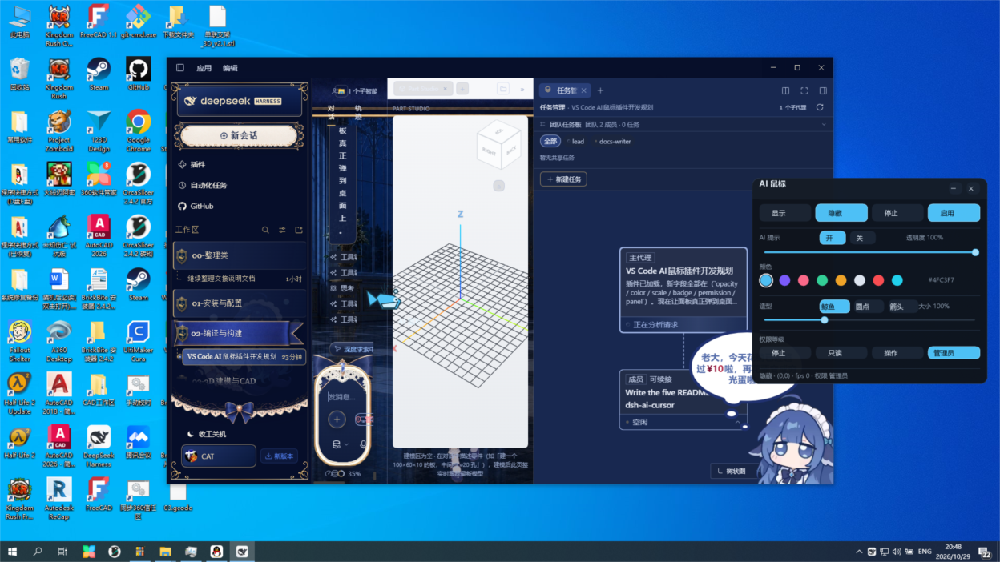
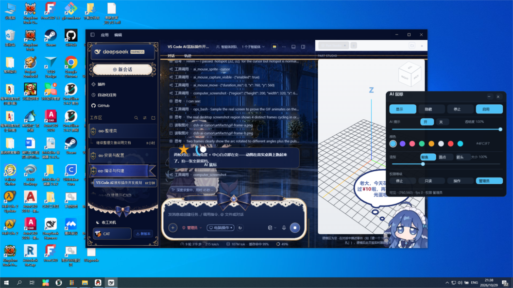

# 交付说明 · dsh-ai-cursor（AI 鼠标）v0.2.0

> 本文件夹是**源码仓库**：`node_modules/`、`lib/`、`overlay/target/`、`bin/*.exe`、`artifacts/` 都不入 git。
> 已在本机（Windows 10/11 + Node 22 + pnpm 11 + Rust 1.99 + VS Code）逐项实测。



> 上图是把浮层设为「可进截图」后、在真实桌面上截的一张：右侧就是浮动控制菜单栏，
> 面板里的青色鲸鱼光标在 (820, 640)。默认情况下这两个窗口都**不会**出现在截图与录屏里。

---

## 1. 做了什么

在原有「AI 光标浮层」基础上，新增一个**浮动、可折叠的控制菜单栏**，并把鼠标个性化、显隐、启停、权限等级全部搬到面板上。

| 能力 | 说明 |
|---|---|
| **AI 光标** | 点击穿透、不进截图、永不移动真实鼠标；鲸鱼 / 圆点 / 箭头三种造型 |
| **浮动面板** | `452×396` 展开 / `132×40` 折叠成小胶囊；顶栏可拖动；`─` `✕` 折叠 |
| **主操作** | 显示 / 隐藏 / 停止 / 启用 |
| **AI 提示** | 开 / 关，控制光标下的「AI 鼠标」徽章 |
| **可变透明度** | 15%–100% 滑条，实时作用于光标与徽章 |
| **颜色设置** | 8 个色板 + `#RRGGBB` 回读，同时驱动光标、徽章描边、面板高亮 |
| **自定义鼠标** | 造型三选一 + 大小 60%–200% 滑条 |
| **权限等级** | 停止 / 只读 / 操作 / 管理员 四档 |

### 权限等级是这次的核心设计

| 等级 | 名称 | Agent 能做什么 |
|---|---|---|
| 0 | 停止 | 只有 `status` |
| 1 | 只读 | + `show` / `hide` / `panel` |
| 2 | 操作 | + `move` |
| 3 | 管理员 | + `label` / `theme` / `badge` / `opacity` / `color` / `scale`，以及**降低**等级 |

规则：**Agent 只能降级，不能升级；只有人点面板才能把控制权还回去。**
所以 `ai_mouse_stop` 对 Agent 是一扇单向门——它能把自己关掉，但关不回来。
双保险：TS 层按工具门禁先拦一次，Rust 层再按命令权限拦一次。

---

## 2. 已经验证到什么程度（本机实测，不是「应该能跑」）

### 2.1 编译与静态检查

| # | 验证项 | 结果 | 证据 |
|---|---|---|---|
| 1 | Rust 浮层编译 | ✅ 0 error / **0 warning** | `cargo build --release` |
| 2 | 在 VS Code 里一键编译 | ✅ 任务 `all (install → overlay → check → build)` 全绿 | VS Code 任务面板截图 |
| 3 | 在 VS Code 终端跑四条命令 | ✅ `OVERLAY_EXIT=0 TYPECHECK_EXIT=0 TEST_EXIT=0 BUILD_EXIT=0` | 终端回显 |
| 4 | TypeScript 类型检查 | ✅ `tsc --noEmit` 通过 | 本机执行 |
| 5 | 单元测试 | ✅ 11/11 | `vitest run` |
| 6 | tsdown 打包 | ✅ `lib/index.js` 19.86 kB / `lib/index.d.ts` 5.14 kB | 构建输出 |

### 2.2 浮层进程自测（协议级，35 项全过）

`pnpm run test:overlay` → **35/35 passed**，覆盖：

- 显隐、移动、坐标回读
- 透明度 / 颜色 / 大小 / 徽章 / 造型 的写入与回读
- 权限阶梯：L1 下 `move` 被拒、Agent 无法提权、`pause` 后 `show`/`move`/`resume`/`panel` 全被拒
- 折叠 / 展开、截图亲和性切换（重建窗口后回读一致）
- `dump` 真正写出 BMP 后才回 `ok`（不会出现「回了 ok 但文件还没落盘」）

### 2.3 桌面真实点击（人工等价操作，截图留证）

用真实鼠标在**屏幕上的面板**逐项点击，每次点击后回读进程状态：

| # | 操作 | 结果 | 证据 |
|---|---|---|---|
| 7 | 点 `─` 折叠 | ✅ `panel_expanded=False`，窗口 `132×40` | `artifacts/click1-collapsed.png` |
| 8 | 点小胶囊展开 | ✅ `panel_expanded=True`，`452×396` | `click2-*.png` |
| 9 | 点紫色色板 | ✅ `color=#7C5CFF`，面板整块变紫 | `click2-*.png` |
| 10 | 点「圆点」造型 | ✅ `theme=dot`，光标变成圆点 | `click2-*.png` |
| 11 | 拖透明度滑条到 50% | ✅ `opacity=0.575` → 读数「透明度 57%」 | `click3-*.png` |
| 12 | 点「停止」 | ✅ `permission=0`、光标消失、页脚「隐藏 / 权限 停止」 | `click3-*.png` |
| 13 | 点「管理员」 | ✅ `permission=3`、光标重新出现 | `click4` 前一步截图 |
| 14 | 拖动顶栏 | ✅ 面板从 `x=1444` 移到 `x=1144`（精确 300px） | 状态回读 |
| 15 | 点「隐藏」再「显示」 | ✅ `visible` 随之翻转 | `click5-*.png` |
| 16 | 拖大小滑条 | ✅ `scale=1.72` → 读数「大小 172%」 | `click5-*.png` |
| 17 | 点「AI 提示 → 关」 | ✅ `badge=False`，徽章消失 | `click5-*.png` |

### 2.4 重启后在真实界面验收（交付门槛）

重建 `lib/index.js` 后重启宿主，在**真实的桌面会话**里逐项确认：

| # | 验证项 | 结果 | 证据 |
|---|---|---|---|
| 18 | 插件重新加载 | ✅ 宿主提示「工具已更新 · 新增 7 个」 | 截图 |
| 19 | 14 个工具全部可用 | ✅ `ai_mouse_status` 返回新字段 `opacity/color/scale/badge/permission/panel` | 工具返回 |
| 20 | 面板出现在桌面 | ✅ 真实渲染在右侧，底部状态行实时刷新 | `docs/panel-on-desktop.png` |
| 21 | 点 `─` 折叠（宿主进程） | ✅ `panel=chip` | `ai_mouse_status` |
| 22 | 点胶囊展开 | ✅ `panel=full` | 截图 |
| 23 | 自动隐藏 | ✅ 60s 无移动后光标隐藏、面板状态行同步为「隐藏」 | 截图 |
| 24 | 聊天框可输入 | ✅ 输入中文后正常回显 | 区域截图 |
| 25 | 权限菜单可打开 | ✅ 显示「当前：管理员」，含 仅可查看 / 工作区内修改 / 完全访问 | 截图 |
| 26 | 页面不白屏、不卡启动页 | ✅ 会话、工具卡片、推理块均正常渲染 | 截图 |

### 2.4.1 图案管线（v0.4.0）实机验证

| # | 验证项 | 结果 | 证据 |
|---|---|---|---|
| 27 | 素材目录扫描 | ✅ 列出 4 个文件（svg/png/gif） | `ai_mouse_assets` |
| 28 | 动图 GIF 加载 | ✅ `cursor=spin.gif/6f`，6 帧 | 工具回读 |
| 29 | 动图在真实桌面动起来 | ✅ 8 次抓屏得到 4 个循环帧 | `artifacts/gif-frame-a|b.png` |
| 30 | 真透明（非键控） | ✅ 渐隐 PNG 渲染出 96 个色阶 | 自测 9/9 |
| 31 | SVG 光栅化 | ✅ star.svg 装到附属图案槽并显示 | `docs/sprites-on-desktop.png` |
| 32 | 附属图案偏移/锚点/透明度 | ✅ 40px、锚点居中、偏移 -70、opacity 0.8 | 同上 |



### 2.5 开发过程中被自测抓出来的真实 bug（都已修）

1. **颜色通道反转**：`COLORREF` 是 `0x00BBGGRR`，我按 `0xRRGGBB` 直填，导致青色显示成黄色。已修。
2. **`─` / `✕` 点不动**：顶栏拖拽区 `(0,0,PW,40)` 先入栈、命中用 `find()` 取第一个，点按钮变成拖窗口。改成命中时**可交互控件优先于拖拽区**。
3. **面板被钉死在屏幕原点**：`UpdateLayeredWindow` 的 `pptDst` 会**移动窗口**，面板每次重绘都传 `(0,0)`，于是被拽回左上角。改成传 `None`（保持原位）。
4. **构建脚本谎报成功**：`cargo` 失败时脚本会保留旧 exe 并 `exit 0`，CI 和任务面板都会绿灯。改成默认失败即报错，只对 `prepack --if-missing` 宽容；并加了 cargo 自动探测（PATH 里没有 rust 也能找到）。
5. **面板状态行不刷新**：面板只在控件变化时重绘，光标自己移动/自动隐藏时底部仍显示旧的「隐藏 (0,0)」。改成按 4Hz 节流刷新（避免每帧重绘整块面板）。

### 2.6 已知限制（如实说明）

- **仅 Windows 10 2004+**（依赖 `WDA_EXCLUDEFROMCAPTURE`）。macOS / Linux 未实现。
- 面板**不支持键盘操作**（无焦点窗口，故意如此）；所有操作靠鼠标。
- 面板位置每次启动重置到屏幕右侧居中，不持久化。
- 徽章文字目前不支持在面板上直接编辑（用 `ai_mouse_label` 工具或配置项）。

---

## 3. 在 VS Code 里怎么编译

```powershell
# 依赖：Node 22+、pnpm 11+、Rust + MSVC 生成工具（编译浮层用）
pnpm install
pnpm run build:overlay    # cargo build --release → 拷贝到 bin/ai-mouse-overlay.exe
pnpm run typecheck
pnpm test
pnpm run build            # tsdown → lib/index.js
```

或者用任务面板（`Ctrl+Shift+P` → `Tasks: Run Task` → `all (install → overlay → check → build)`），
它会按顺序跑完上面全部步骤。

> ⚠️ 若 `cargo` 不在 PATH：`pnpm run build:overlay` 会自动探测
> `%USERPROFILE%\.cargo\bin\cargo.exe`、`E:\rust\cargo\bin\cargo.exe` 等常见位置，
> 并补齐 `CARGO_HOME` / `RUSTUP_HOME`；也可以用 `CARGO=<绝对路径>` 指定。

### 本地试装

```powershell
dsh plugin --profile desktop add link:<本文件夹绝对路径>
```

装完**重启 Harness**，然后在会话里：

```text
ai_mouse_panel { visible: true }            # 弹出控制面板
ai_mouse_move  { x: 900, y: 500 }
ai_mouse_color { hex: "#7C5CFF" }           # 需要「管理员」等级
```

---

## 4. 提交 / 发布（已完成到什么程度）

| 事项 | 状态 |
|---|---|
| GitHub 开源仓库 | ✅ <https://github.com/CAT0998/dsh-ai-cursor>（public，topic `dsh-plugin` 等 5 个） |
| 版本发布 | ✅ [v0.2.0](https://github.com/CAT0998/dsh-ai-cursor/releases/tag/v0.2.0) |
| 预构建 tarball（免 Rust 安装） | ✅ `releases/latest/download/dsh-ai-cursor.tgz`（含 `bin/ai-mouse-overlay.exe`） |
| 中文 / 英 / 西 / 印地 / 葡 五语 README | ✅ 结构、代码块、表格一一对应 |
| 插件市场条目 | ✅ 已提交到 fork 分支 `add-dsh-ai-cursor` |
| 插件市场 PR | ⏳ **受「仓库创建满 1 天」自动检查限制**，2026-10-30 20:37 之后可提 |

### 两个环境限制（不是代码问题）

1. **`github.com:443` 在本机不通**（`api.github.com` 正常），所以 `git push` 会超时。
   提交改走 REST Git Data API：`python scripts/push-via-api.py`。
2. **`.github/workflows/ci.yml` 未推上去**：GitHub 要求 token 带 `workflow` scope，
   当前 gh token 只有 `gist, read:org, repo`，且对缺权限的 workflow 写入**故意回 404**。
   解锁：`gh auth refresh -s workflow`（需浏览器交互），然后重跑上面的推送脚本。

### 发布到市场（一条命令）

```sh
python scripts/stage-marketplace-entry.py --pr
```

条目内容与收录要求见 `docs/MARKETPLACE.md`：`dsh.bundle` 清单（已有）、真实代码、
仓库满 1 天、`dsh-plugin` topic。

- **npm 发布时 `bin/ai-mouse-overlay.exe` 必须存在**（用户不会装 Rust）。
  `prepack` 会自动构建并在缺失时保留预构建产物。

---

## 5. 文件地图

```
dsh-ai-cursor/
├─ src/
│  ├─ index.ts        # Cordis 插件：14 个 ai_mouse_* 工具 + 权限门禁
│  ├─ overlay.ts      # 浮层子进程：spawn / 行协议 / 超时 / 回收
│  ├─ config.ts       # Schemastery 配置（13 项）
│  └─ permissions.ts  # 权限等级定义与校验（纯函数，可单测）
├─ overlay/
│  ├─ Cargo.toml
│  └─ src/main.rs     # Win32 两个分层窗口 + GDI 超采样绘制 + 面板命中测试
├─ scripts/
│  ├─ build-overlay.mjs        # cargo 构建 + 拷 exe + cargo 自动探测
│  ├─ selftest-overlay.py      # 协议级自测（35 项）
│  ├─ run-overlay-selftest.mjs # pnpm run test:overlay 的入口
│  ├─ live-panel-session.py    # 常驻会话，供真实鼠标点击测试
│  ├─ push-via-api.py          # 本机 github.com:443 不通，走 REST API 推送
│  └─ stage-marketplace-entry.py # fork + 条目文件 + 可选开 PR
├─ tests/index.test.ts         # vitest（纯函数，11 项）
├─ docs/DESIGN.md              # 设计文档 + 协议表
├─ docs/MARKETPLACE.md         # 上架市场的条目与步骤
├─ docs/panel-on-desktop.png   # 面板实机截图
├─ .vscode/tasks.json          # VS Code 一键构建任务
├─ .github/workflows/ci.yml    # Windows runner：typecheck/test/overlay/build/pack
├─ bin/                        # 构建产物落点（git 忽略）
├─ locale/{en,zh}.json
├─ README.md / README-zh.md / README-es.md / README-hi.md / README-pt.md
└─ LICENSE                     # Apache-2.0
```

---

## 6. 协议（浮层 stdin/stdout，一行一个 JSON）

| 命令 | 最低权限 | 作用 |
|---|---|---|
| `{"cmd":"show"}` / `hide` | 1 | 显隐光标 |
| `{"cmd":"move","x","y","duration_ms"}` | 2 | 滑到绝对屏幕坐标 |
| `{"cmd":"panel","visible":bool}` | 1 | 显示/隐藏面板 |
| `{"cmd":"panel_expanded","expanded":bool}` | 1 | 展开/折叠 |
| `{"cmd":"opacity","value":0.15~1}` | 3 | 光标透明度 |
| `{"cmd":"color","hex":"#RRGGBB"}` | 3 | 主色 |
| `{"cmd":"scale","value":0.6~2}` | 3 | 光标尺寸 |
| `{"cmd":"badge","visible":bool}` | 3 | AI 提示显隐 |
| `{"cmd":"theme","theme":"whale"\|"dot"\|"arrow"}` | 3 | 造型 |
| `{"cmd":"label","text":"..."}` | 3 | 徽章文字 |
| `{"cmd":"permission","level":0~3}` | 3（只能降） | 权限等级 |
| `{"cmd":"pause"}` / `resume` | 3 | 等价 停止/启用（`resume` 在 0 级时会被拒） |
| `{"cmd":"idle","idle_ms":n}` | 系统 | 自动隐藏 |
| `{"cmd":"affinity","capture_visible":bool}` | 系统 | 是否进截图（重建窗口） |
| `{"cmd":"dump","path":"...","target":"cursor"\|"panel"}` | 系统 | 自绘一帧到 BMP（落盘后才回 ok） |
| `{"cmd":"status"}` | 任何 | 回读状态 |
| `{"cmd":"quit"}` | 系统 | 退出 |

每条命令回一行 JSON，带同一个 `id`。
